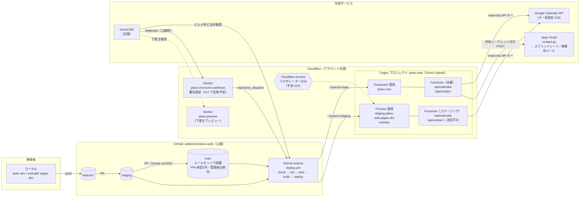
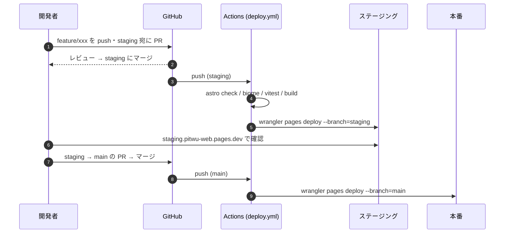
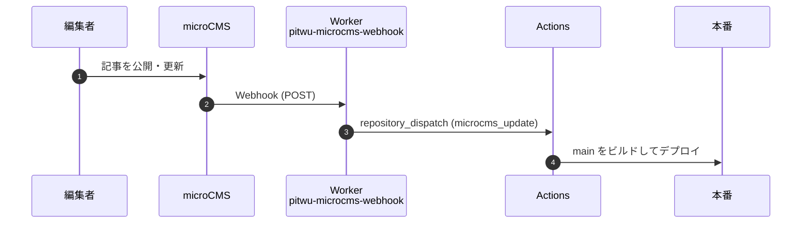

# 環境構成 — 本番 / ステージング / ローカル

pitwu.com（夢源風人 公式サイト）がどこで動き、どう反映されるかの全体図。
ローカル開発の始め方は [`setup.md`](setup.md) を参照。

> 最終確認日: 2026-10-10（Cloudflare API・GitHub・実URLで確認した実態に基づく）

---

## 1. 環境の一覧

| 環境 | URL | 何が入るか | 誰が見るか | 状態 |
|------|-----|-----------|-----------|------|
| **本番 (Production)** | https://pitwu.com<br>https://pitwu-web.pages.dev | `main` ブランチ | 一般公開 | ✅ 稼働中 |
| **ステージング (Preview)** | https://staging.pitwu-web.pages.dev | `staging` ブランチ | 開発メンバー・確認者 | ✅ 稼働中（2026-10-10〜。残作業は [§5](#5-ステージングの構築手順初回のみ管理者) の進捗表） |
| **個別デプロイURL** | `https://<id>.pitwu-web.pages.dev` | デプロイ1回ごとの固定スナップショット | 確認・ロールバック用 | ✅ 自動発行 |
| **ローカル** | http://localhost:4321 | 手元の作業ツリー | 自分 | [`setup.md`](setup.md) |

本番とステージングは **同じ Cloudflare Pages プロジェクト `pitwu-web` の Production / Preview 環境**
で分ける。プロジェクトは1つ、環境変数だけが環境ごとに別、という形。

---

## 2. 全体構成図



ポイント:

- **サイト本体は完全静的（SSG）**。HTML はビルド時に microCMS から記事を取ってきて作る。
  ランタイムに動くのは Pages Functions（`functions/api/*`）の2本だけ。
- **Pages プロジェクトは Git 連携していない（Direct Upload）**。Cloudflare 側ではビルドせず、
  GitHub Actions がビルドした `dist/` を `wrangler pages deploy` で送り込む。
  Cloudflare ダッシュボードの「ビルド設定」は使われていない。
- **どの環境に入るかは `--branch` で決まる**。Pages の production branch は `main`。
  それ以外のブランチ名でデプロイすると Preview 環境に入り、`<ブランチ名>.pitwu-web.pages.dev`
  というエイリアスURLが付く。
- **問い合わせ（`/api/contact`）が Apps Script に届くのは本番だけ**。ステージングは送り先を外してあり、送信はエラー表示になる（[§5 手順3](#手順3-問い合わせフォームを本番から切り離す)）。
- 図中の「#番号」は対応待ちの issue。片付いたら図からも外す。
- **Preview 環境（`*.pages.dev`）には Cloudflare が自動で `X-Robots-Tag: noindex` を付ける**
  ので、ステージングが検索に載る心配はない。

---

## 3. デプロイの流れ

### 3-1. コード変更（通常の開発）



- ビルドは microCMS の全件取得があるため **15〜20分** かかる。
- check / lint / test のどれかが落ちるとデプロイされない（その環境は前の版のまま）。

### 3-2. 記事更新（microCMS）



- 記事更新で再ビルドされるのは **本番のみ**（`repository_dispatch` は既定ブランチ `main` で走る）。
  ステージングに最新記事を反映したいときは `staging` に push するか、Actions から
  `staging` を指定して手動実行（`gh workflow run deploy.yml --ref staging`）。
- microCMS はステージング・本番で **同じサービスを共有**している。下書きの見た目確認は
  ステージングではなく `pitwu-preview` Worker（`?id=…&key=…`）を使う。

---

## 4. 環境ごとの設定（どこに何があるか）

### 4-1. 設定値の置き場所

| 値 | ローカル | GitHub Actions (Secrets) | Pages: Production | Pages: Preview（ステージング） | 用途 |
|----|:-------:|:------------------------:|:-----------------:|:-----------------------------:|------|
| `MICROCMS_SERVICE_DOMAIN` | `.env` | ✅ | — | — | ビルド時の記事取得 |
| `MICROCMS_API_KEY` | `.env` | ✅ | — | — | 同上（GET 権限のみのキー） |
| `CLOUDFLARE_API_TOKEN` | `.env`（任意） | ✅ | — | — | `wrangler pages deploy` |
| `CLOUDFLARE_ACCOUNT_ID` | `.env`（任意） | ✅ | — | — | 同上 |
| `GOOGLE_CALENDAR_API_KEY` | `.dev.vars` | — | ⚠️ **未設定** | 未設定 | `/api/calendar` |
| `EVENT_CALENDAR_ID` / `PRACTICE_CALENDAR_ID` | `.dev.vars`（任意） | — | 未設定（既定値を使用） | 未設定 | カレンダーIDの上書き |
| `CONTACT_ENDPOINT` | `.dev.vars`（任意） | — | ✅ | 未設定（ステージング用 Apps Script 待ち） | `/api/contact` の転送先 |
| `CONTACT_SHARED_SECRET` | `.dev.vars`（任意） | — | ✅ (secret) | 未設定（同上） | 同上 |
| `GOOGLE_SERVICE_ACCOUNT_EMAIL` / `GOOGLE_PRIVATE_KEY` | `.env` | — | — | — | `scripts/gcal.ts`（予定の読み書き。ローカル専用） |

- `MICROCMS_*` は **ビルド時にしか使わない**ので Pages 側には不要。GitHub Secrets だけにあればよい。
- Pages Functions が読む値（`GOOGLE_CALENDAR_API_KEY`, `CONTACT_*`）は **Pages の環境変数**
  （Settings → Variables and Secrets）に、Production / Preview それぞれ設定する。
- Pages の環境変数を変えたら **再デプロイしないと反映されない**。

### 4-2. Workers（Pages とは別にデプロイ）

| Worker | ソース | Secrets | 役割 |
|--------|--------|---------|------|
| `pitwu-microcms-webhook` | `workers/microcms-webhook/` | `GITHUB_PAT`, `MICROCMS_WEBHOOK_SECRET` | microCMS の Webhook を GitHub の `repository_dispatch` に中継。`X-MICROCMS-Signature` の署名が合わないリクエストは 401 で捨てる |
| `pitwu-preview` | `workers/preview/` | `MICROCMS_SERVICE_DOMAIN`, `MICROCMS_API_KEY` | microCMS 下書きのプレビュー表示 |

どちらも環境は1つ（本番のみ）で、GitHub Actions ではなく手動 `npx wrangler deploy` で更新する。
URL は Cloudflare ダッシュボードで確認する（このリポジトリは公開なので、URL は書かない）。

`MICROCMS_WEBHOOK_SECRET` は microCMS の Webhook 設定の「シークレット値」と同じ値にする。
変えるときは両方を同時に変える（片方だけだと記事更新で再ビルドされなくなる）。

> 同じ Cloudflare アカウントに `pitwu-app` / `pitwu-app-staging` / `pitwu-cron` も載っているが、
> これらは別リポジトリ（pitwu-app）のもの。このリポジトリからは触らない。

### 4-3. 外部サービス

| サービス | 本番 | ステージング | 備考 |
|----------|------|-------------|------|
| microCMS | 共有 | 共有 | 同じ公開記事が出る |
| Google Calendar | 共有 | 共有 | 読み取りのみなので共有で問題なし |
| Apps Script（問い合わせ） | 本番用デプロイ | 専用を用意する（[§5 手順3](#手順3-問い合わせフォームを本番から切り離す)）。それまでステージングの問い合わせは送信エラーになる | 共有すると事務局に本物の通知メールが飛ぶ |
| DNS | Cloudflare（`pitwu.com`） | 不要（`pages.dev`） | |

---

## 5. ステージングの構築手順（初回のみ・管理者）

### 進捗（2026-10-10）

| 手順 | 状態 |
|------|------|
| 1. `deploy.yml` を staging 対応 | ✅ PR #16 |
| 2. `staging` ブランチ作成 | ✅ |
| 3. 問い合わせを本番から切り離す | ✅ Preview の `CONTACT_*` を削除済み（本番に届かない）。⏳ ステージング用 Apps Script を作って入れれば送信テストも可能になる |
| 4. カレンダー API キー | ⏳ キーの発行待ち（本番も未設定） |
| 5. ステージングに鍵をかける | ⏳ Cloudflare Zero Trust の有効化待ち |
| 6. `main` の保護 | ⏳ ルールセット設定待ち |

Cloudflare と GitHub の管理権限がある人が1回だけ行う。

### 手順1. `deploy.yml` を staging 対応にする

[`.github/workflows/deploy.yml`](../.github/workflows/deploy.yml) を次のように変える。

```diff
 on:
   repository_dispatch:
     types: [microcms_update]
   push:
-    branches: [main]
+    branches: [main, staging]
   workflow_dispatch:

+# 同じブランチへの連続 push は古い方を打ち切る（main と staging は並行して走れる）
+concurrency:
+  group: deploy-${{ github.ref_name }}
+  cancel-in-progress: true
+
 ...
-          command: pages deploy dist --project-name=pitwu-web
+          # --branch が production branch（main）なら Production、それ以外は Preview に入る
+          command: pages deploy dist --project-name=pitwu-web --branch=${{ github.ref_name }}
```

`--branch` を明示しておくと、どのブランチから走っても入る環境を取り違えない。

### 手順2. `staging` ブランチを作る

```bash
git switch main && git pull
git switch -c staging
git push -u origin staging
```

push すると Actions が走り、終わると https://staging.pitwu-web.pages.dev が見られるようになる。

### 手順3. 問い合わせフォームを本番から切り離す

**現状、Preview 環境にも本番と同じ `CONTACT_ENDPOINT` / `CONTACT_SHARED_SECRET` が入っている。**
このままステージングから送信すると、本番のスプレッドシートに行が増え、事務局に本物の通知メールが届く。
次のどちらかにする。

- **A. ステージング用 Apps Script を用意する（推奨）**
  [`operations.md` の問い合わせフォーム手順](operations.md#問い合わせフォームcontact) を
  もう一度行い、別のスプレッドシート・別の `SHARED_SECRET`・`NOTIFY_TO` を開発者のアドレスにした
  デプロイを作る。その `/exec` URL とシークレットを **Preview** 側の環境変数に入れる。
- **B. Preview から `CONTACT_*` を消す**
  `/api/contact` は `configured:false` を返し、フォームは送信時にエラーと代替手段を表示する
  （成功したふりはしない設計）。フォーム自体の動作確認はできなくなる。

確認:

```bash
curl -s https://staging.pitwu-web.pages.dev/api/contact
# A: {"ok":true,"configured":true}   B: {"ok":true,"configured":false}
```

### 手順4. カレンダーの API キーを入れる

Pages → Settings → Variables and Secrets で、**Production と Preview の両方**に
`GOOGLE_CALENDAR_API_KEY`（Calendar API だけ許可した read-only キー）を追加し、再デプロイ。

```bash
curl -s https://staging.pitwu-web.pages.dev/api/calendar | head -c 200
# {"error":"API key not configured",...} が出なければOK
```

### 手順5. ステージングに鍵をかける（推奨）

ステージングには未公開の変更が出るので、Cloudflare Access で開発メンバーだけに絞る。

1. Pages → `pitwu-web` → Settings → General → **Access policy** を有効化
   （Preview デプロイ全体＝`*.pitwu-web.pages.dev` に Access がかかる）
2. Zero Trust → Access → Applications で、許可するメールアドレス（開発メンバー）を設定

> 注: 鍵がかかるのは Preview 側だけ。本番は一般公開サイトなので認証は持たない（メンバー向けの内容は pitwu-app 側で扱う）。

### 手順6. `main` を保護する（推奨）

GitHub → Settings → Branches で `main` にルールを追加:

- PR 必須（直接 push 禁止）
- ステータスチェック必須（`deploy` ジョブ）※ PR 時にも check/lint/test を走らせる
  ワークフローを別途足す場合

チーム開発で「誰かの直 push がそのまま本番に出る」のを防ぐ。

---

## 6. 既知の問題（2026-10-10 時点）

調査中に見つかった、本番で直すべき点。

| # | 問題 | 影響 | 対応 |
|---|------|------|------|
| 1 | **`/members/*`（会報「みてぴとぅ」含む）が認証なしで公開されていた** | 誰でも閲覧でき、サイトマップにも載っていた | pitwu-app へ移管する方針。サイトとリポジトリからは削除済み（2026-10、`chore/isolate-members`）。残作業は §8 |
| 2 | **本番に `GOOGLE_CALENDAR_API_KEY` が未設定** | `/api/calendar` が `API key not configured` を返し、`/schedule/` に予定が出ない | §5 手順4 |
| 3 | **`www.pitwu.com` が 522** | www 付きでアクセスした人にエラー画面 | Pages の Custom domains に `www.pitwu.com` を追加、または apex へのリダイレクトルールを設定 |
| 4 | ~~Preview の `CONTACT_*` が本番と同じ~~ | — | 解消（2026-10-10、Preview から削除） |

---

## 7. ロールバック

- **本番**: Cloudflare → Workers & Pages → `pitwu-web` → Deployments → 戻したい版の「…」→
  **Rollback to this deployment**。ビルドし直さないので即時。
- **原因コードも戻す**: `git revert <commit>` → `main` に push（次のデプロイで再び壊れないように）。
- 個別デプロイURL（`https://<id>.pitwu-web.pages.dev`）は消えないので、過去版の見た目確認に使える。

---

## 8. メンバー向けコンテンツの隔離（2026-10）

メンバーページ（`/members/`）と会報「みてぴとぅ」のバックナンバーは、このサイトの管轄外とし、
pitwu-app（非公開リポジトリ・ログインあり）に移管する。このサイトでは認証を持たない。

| 対象 | 元の場所 | 状態 |
|------|---------|------|
| ページ | `src/pages/members/`（`index` / `secret` / `mitepitwu/`） | 削除。`/members/*` は 404 |
| 本文データ | `src/data/wp-pages.json` の `mitepitwu`（5号分） | 削除 |
| 画像 | `public/images/mitepitwu/`（85枚・約38MB） | 削除 |

移管元データ（本文・画像・元のページ）は pitwu-app リポジトリ（非公開）の `migration/mitepitwu/` にコピーした。
このリポジトリでは **Git の履歴からも除去**した（2026-10-10、`git filter-repo` で全ブランチを書き換えて force push）。

> 履歴を書き換えたので、それ以前に clone した人は **clone し直す**こと（古い clone から push すると消したデータが戻る）。

残作業:

- [x] pitwu-app へコピー（`migration/mitepitwu/`）
- [ ] pitwu-app 側でログイン必須のページとして取り込む
- [ ] 過去の個別デプロイURL（`https://<id>.pitwu-web.pages.dev/members/`）は古いスナップショットのまま配信され続ける。消すなら Cloudflare で古いデプロイを削除（ロールバック先も消える）
- [ ] 検索エンジンに載っている分は、404 になれば順次消える。急ぐなら Google Search Console の「削除」で `/members/` 配下を申請
