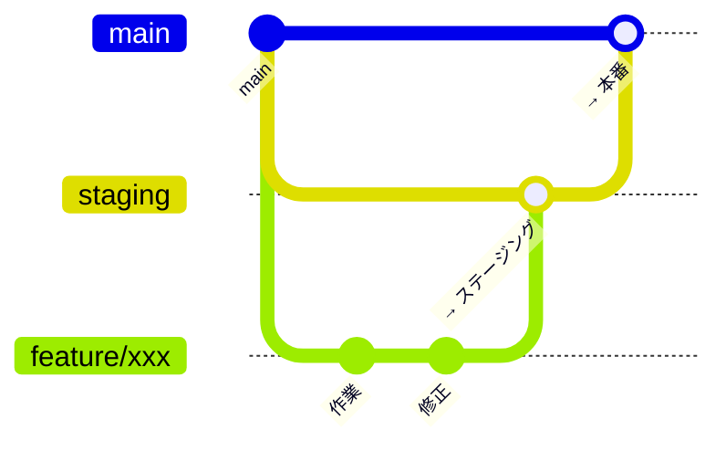

# 開発環境構築ガイド

pitwu-web の開発に新しく加わる人向け。上から順に進めれば、手元でサイトを動かし、
ステージング経由で本番に出すところまでできる。

環境の全体像（本番・ステージングの構成図）は [`environments.md`](environments.md) を参照。

---

## 0. 最初に管理者へ依頼するもの

| 項目 | 必須 | 用途 |
|------|:---:|------|
| GitHub `akibecolor/pitwu-web` の Write 権限 | ✅ | ブランチの push・PR |
| microCMS の **GET 権限のみの API キー**とサービスドメイン | ✅ | ローカルでビルド・表示するため（記事データを取得する） |
| microCMS 管理画面のアカウント | 記事を触るなら | 記事の作成・編集 |
| Cloudflare アカウントへの招待 | デプロイ・設定を触るなら | ダッシュボードの閲覧、Pages の環境変数、ロールバック |
| ステージングの閲覧許可（Cloudflare Access） | ステージング構築後 | `staging.pitwu-web.pages.dev` を開くため |
| Google Calendar API キー / サービスアカウント | カレンダーを触るなら | `/schedule/` の表示確認、`scripts/gcal.ts` |

> 鍵類は Slack 等に平文で貼らず、1Password などの共有保管庫から受け取る。
> 本番用の書き込みキー（microCMS の書き込み権限・`CLOUDFLARE_API_TOKEN` 等）は通常の開発では不要。

---

## 1. 必要なツール

| ツール | バージョン | 確認コマンド |
|--------|-----------|-------------|
| Node.js | **22.12 以上**（CI は 22） | `node -v` |
| npm | Node 同梱 | `npm -v` |
| Git | 任意の最近の版 | `git --version` |
| GitHub CLI（任意） | — | `gh --version` |

Windows / macOS どちらでも動く。Node のバージョン管理は fnm・Volta・nvm など好みで。

---

## 2. 取得とインストール

```bash
git clone https://github.com/akibecolor/pitwu-web.git
cd pitwu-web
npm ci
```

`npm install` ではなく `npm ci` を使う（`package-lock.json` どおりに入れる。CI と同じ）。

---

## 3. 環境変数

### 3-1. `.env`（必須）

```bash
cp .env.example .env
```

最低限これだけ埋めれば動く:

```dotenv
MICROCMS_SERVICE_DOMAIN=<サービスドメイン>
MICROCMS_API_KEY=<GET権限のみのキー>
```

未設定だと `microCMS env vars が未設定` というエラーで dev サーバーもビルドも止まる。
他の項目（Google サービスアカウント、Cloudflare トークン）は必要になったときに。

### 3-2. `.dev.vars`（API を手元で動かすときだけ）

`/api/calendar` と `/api/contact`（Pages Functions）を手元で動かす場合、
wrangler はプロジェクト直下の `.dev.vars` を読む。

```dotenv
GOOGLE_CALENDAR_API_KEY=<read-only キー>
# 問い合わせを試すなら、必ずステージング用 Apps Script の値を入れる（本番の値は使わない）
# CONTACT_ENDPOINT=https://script.google.com/macros/s/.../exec
# CONTACT_SHARED_SECRET=...
```

`.env` と `.dev.vars` はどちらも `.gitignore` 済み。**コミットしないこと。**

---

## 4. 起動

### 4-1. 普段の開発（ページ・見た目）

```bash
npm run dev        # http://localhost:4321
```

ホットリロードあり。ただし **`/api/*`（Pages Functions）は動かない**ので、
スケジュールページは「予定なし」、問い合わせフォームは送信エラーになる。これは正常。

### 4-2. 本番に近い形で確認（API 込み）

```bash
npm run build                     # 15〜20分かかる（記事全件取得 + 検索インデックス生成）
npx wrangler pages dev dist       # http://localhost:8788
```

`dist/` を Cloudflare と同じランタイムで配信し、`functions/` も動く。
デプロイ前の最終確認や、検索（Pagefind）の確認はこちらで。

---

## 5. コミット前のチェック

CI（GitHub Actions）と同じものを手元で通しておく。どれかが落ちると**デプロイされない**。

```bash
npm run check      # 型チェック（astro check）
npm run lint       # Biome
npm test           # Vitest
```

---

## 6. ブランチと出し方



1. `staging` から作業ブランチを切る: `git switch staging && git pull && git switch -c feature/xxx`
   - 名前の例: `feature/calendar-ui`, `fix/contact-form`, `docs/setup`
2. push して **`staging` 宛て**に PR を出す → レビュー → マージ
3. 数十分後、https://staging.pitwu-web.pages.dev で確認
4. 問題なければ **`staging` → `main`** の PR を出してマージ → 本番に出る

| やること | 宛先 |
|---------|------|
| 普段の機能追加・修正 | `feature/*` → `staging` → `main` |
| 本番障害の緊急修正 | `fix/*` → `main`（直後に `main` を `staging` へマージして揃える） |
| 記事の追加・修正 | コード変更不要。microCMS で公開すると本番が自動で再ビルドされる |

> ステージングが未構築の間（[`environments.md` §5](environments.md#5-ステージングの構築手順初回のみ管理者) 参照）は
> `feature/*` → `main` の PR で運用し、確認は §4-2 のローカル確認で代える。

コミットメッセージは既存に合わせて Conventional Commits 風（`feat(contact): …`, `fix: …`, `docs: …`）。

---

## 7. よく使うコマンド

| コマンド | 内容 |
|---------|------|
| `npm run dev` | 開発サーバー（:4321） |
| `npm run build` | 本番ビルド（`dist/`） |
| `npx wrangler pages dev dist` | ビルド結果を Functions 込みで配信（:8788） |
| `npm run check` / `lint` / `test` | CI と同じチェック |
| `npx tsx scripts/gcal.ts` | Google Calendar の予定操作（サービスアカウントが必要） |
| `gh workflow run deploy.yml --ref <branch>` | ビルド・デプロイを手動実行（環境変数を変えた後など） |
| `gh run list --workflow=deploy.yml` | デプロイの実行状況 |

---

## 8. つまずいたとき

| 症状 | 原因と対処 |
|------|-----------|
| `microCMS env vars が未設定` | `.env` が無い・値が空。§3-1 |
| `npm ci` が失敗する | Node が古い。22.12 以上にする |
| `/schedule/` に予定が出ない（ローカル） | `npm run dev` では Functions が動かない。§4-2 の方法で、`.dev.vars` に API キーを入れる |
| 検索ページで何も出ない（ローカル） | 検索インデックスはビルド時に生成される。`npm run dev` では出ない。§4-2 |
| push したのに反映されない | Actions のログを確認（`gh run list --workflow=deploy.yml`）。check/lint/test で落ちていることが多い。ビルド自体も15〜20分かかる |
| Pages の環境変数を変えたのに効かない | 既存デプロイには反映されない。再デプロイ（`gh workflow run deploy.yml --ref <branch>`） |

---

## 9. 次に読むもの

| ドキュメント | 内容 |
|-------------|------|
| [`environments.md`](environments.md) | 本番・ステージングの構成図、設定値の置き場所、既知の問題 |
| [`operations.md`](operations.md) | コンテンツ更新・問い合わせフォームの運用 |
| [`design.md`](design.md) | アーキテクチャ・設計 |
| [`discography.md`](discography.md) | 作品ページのデータ更新ルール |
